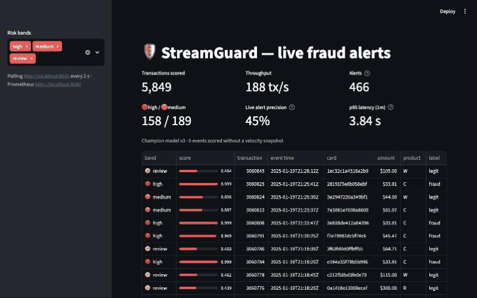
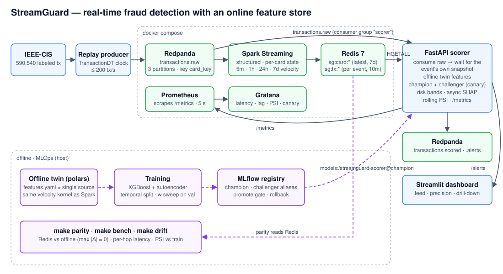

# StreamGuard

**Real-time fraud detection with an online feature store — Kafka → Spark Structured Streaming → Redis → hybrid scoring → live alert dashboard.**

> Status: ✅ **v0.1.0** — runs end to end on one laptop (Docker Compose + host processes). Full spec and milestone log in [PLAN.md](./PLAN.md); one-page write-up in [docs/WRITEUP.md](./docs/WRITEUP.md).



## Results

All numbers come from the commands in the last column. The data is IEEE-CIS (590,540 real, labeled e-commerce transactions), evaluated on a strict temporal split with no shuffling.

| KPI | Target | Result | Proof |
|---|---|---|---|
| **AUPRC, temporal test** | ≥ 0.48 (≥ 95 % of the all-columns ceiling) | **0.489** ✅ (val 0.550) | `make train` → MLflow |
| p95 end-to-end latency @ ~200 tx/s | < 5 s | **4.17 s** ✅ (p50 2.54 s, p99 6.85 s) | `make bench` → `artifacts/bench.json` |
| Online/offline feature parity | max \|Δ\| < 1e-6 | **0** ✅ (1 k cards × 13 features, 60 k events) | `make parity` |
| Live vs offline score parity | — | **0** ✅ (5 k events) | M3 check |
| Recall @ FPR 5 % · precision@50 | report | 0.590 · 1.00 (test) | `make train` |
| Canary gate | promote only if p95 \|Δscore\| < 0.02 | challenger at 0.118 → **refused** ✅ | `make promote` |
| Drift | PSI < 0.2 on top-20 features | mechanics ✅, threshold needs calibration (see limitations) | `make drift`, Grafana |

**About the AUPRC target.** Published XGBoost PR-AUC figures (0.78–0.88) come from other card-fraud datasets. On IEEE-CIS with a temporal split, XGBoost using **all 431 raw columns** reaches only 0.561 on validation and **0.510 on test**, because the last 17 % of the timeline is harder for any model. StreamGuard's 111 streaming-safe features reach 96 % of that test ceiling. The target was re-anchored to the measured ceiling, and every step is recorded in [PLAN.md §8](./PLAN.md#8-evaluation-protocol).

**Latency per hop** (`make bench`, 12 k events @ 177 tx/s):

| hop | p50 (s) | p95 (s) | p99 (s) |
|---|---|---|---|
| broker → Spark → Redis | 1.41 | 2.90 | 5.55 |
| snapshot wait (scorer) | 1.44 | 1.98 | 2.52 |
| inference (features + model) | 0.01 | 0.01 | 0.01 |
| publish | 0.01 | 0.01 | 0.01 |
| **end-to-end** | **2.54** | **4.17** | **6.85** |

Spark's 1-second micro-batch accounts for most of the latency, while the model itself is negligible.

## Architecture



1. **Replay producer:** streams IEEE-CIS rows in `TransactionDT` order on a compressed synthetic clock (≈ 6 months in ≈ 49 min, capped at 200 tx/s), keyed by a hashed `card_key` so per-card order holds within each partition.
2. **Spark Structured Streaming:** keeps exact trailing-window velocity (5 m / 1 h / 24 h / 7 d counts, sums and means, plus time since the previous transaction) per card with `applyInPandasWithState`. It writes the latest snapshot per card (`sg:card:*`) and a per-event snapshot (`sg:tx:*`) to Redis.
3. **FastAPI scorer:** consumes the same topic and **waits for each event's own snapshot**. It builds the feature vector with the *offline* twin's code, scores with the MLflow `champion` (and the `challenger`, as a canary), and publishes scored transactions and banded alerts. SHAP top-5 drivers are attached asynchronously.
4. **Streamlit dashboard:** live feed, counters, live alert precision (labels are replayed with the stream), and a per-alert drill-down showing the velocity snapshot and SHAP drivers.
5. **Prometheus + Grafana:** throughput, alerts by band, latency p50/p95/p99, consumer lag, snapshot hit-rate, PSI per feature, retrain flag, canary delta.

## Design decisions worth a look

- **One contract, one velocity function.** The producer, the offline twin and the Spark job all build from the `Transaction` schema and `configs/features.yaml`. The velocity math is a single numpy function ([velocity.py](src/streamguard/velocity.py)) that Spark runs inside its state function, so the parity check tests the *streaming plumbing* (ordering, state, Redis) rather than two copies of the formulas. Sums run in integer thousandths of a currency unit, so parity is exactly 0.
- **Serving equals training, exactly.** Training features include the current event. Redis only holds a card's *latest* snapshot, which could be from before this event or after it. So Spark also writes a short-lived per-event snapshot, and the scorer waits for it. Live scores matched the offline predictions for every event.
- **Everything decided on validation.** Early stopping, autoencoder calibration, the ensemble weight and the band thresholds all come from validation. The test split is evaluated once per run and only reported.
- **A model version is self-contained.** Each MLflow pyfunc packages the booster, the autoencoder, its preprocessing and calibration, the weight `w` and the feature order. Thresholds come from the version's own run, so a model and its operating point move together.
- **Canary-gated promotion.** New versions register as `challenger`, and the scorer scores every event twice. `make promote` moves the alias only when the 95th-percentile score delta is below 0.02. `make rollback` is a single alias move.

## Quickstart

Prerequisites: Docker (≥ 6 GB RAM allocated), [uv](https://docs.astral.sh/uv/), a free Kaggle account, and on macOS `brew install libomp` (needed by XGBoost).

```bash
make setup                      # uv sync --all-extras; then copy .env.example → .env with your Kaggle token
```

```bash
make data                       # IEEE-CIS train files → data/ (accept the competition rules on Kaggle once)
```

```bash
make up                         # Redpanda, console :8085, Redis, Prometheus :9090, Grafana :3000
```

Then run each of these in its own terminal:

```bash
make mlflow                     # MLflow tracking + registry on :5000
```

```bash
make train                      # hybrid model → MLflow; first version becomes champion (~10 min)
```

```bash
make features                   # Spark Structured Streaming job (container)
```

```bash
make api                        # scorer on :8000
```

```bash
make dashboard                  # Streamlit on :8501
```

```bash
REPLAY_LIMIT=20000 make replay  # stream transactions
```

Checks and operations: `make parity`, `make bench`, `make drift`, `make promote` / `make rollback`, `make test`. `make reset` gives a fresh stream; stop `make api` before running it.

## Limitations & next steps

- **The PSI threshold needs calibrating.** With time compression, the 10–20 k-event live window covers about one simulated week, and a single week naturally sits around PSI 0.2 against months of training data. In the demo the flag fired on a window that lies *inside* the training period, and cyclical day-of-week features always read as drifted. Next step: set the threshold from the distribution of window-to-window PSI within the training data, or use event-time windows.
- **The autoencoder lane adds nothing yet.** Its own val AUPRC is 0.134 (base rate 0.037), and every blend scores below XGBoost alone, so the sweep picks `w = 1.0`. It stays packaged and reported as the "unknown unknowns" lane.
- **Tail latency:** p99 is 6.85 s, driven by the micro-batch timing. Spark's real-time trigger or a smaller trigger interval would shorten it.
- **Serving a new champion** requires restarting `make api`, since aliases are read at startup.
- **Single node only:** Spark runs in local mode with one Redis and no horizontal-scaling story, which is deliberate for a laptop project (see PLAN.md non-goals).
- **macOS:** torch and XGBoost ship separate OpenMP runtimes. The code loads XGBoost first and pins torch to one thread; the alternatives were a segfault and a deadlock, both reproduced.

## Repository

The spec, contracts, milestone log and KPI table are in [PLAN.md](./PLAN.md) (§14 covers the layout). Most of the logic lives in `src/streamguard/`, and `tests/` holds 75 tests covering contracts, feature semantics, micro-batch-split invariance, scoring, the canary and drift.
